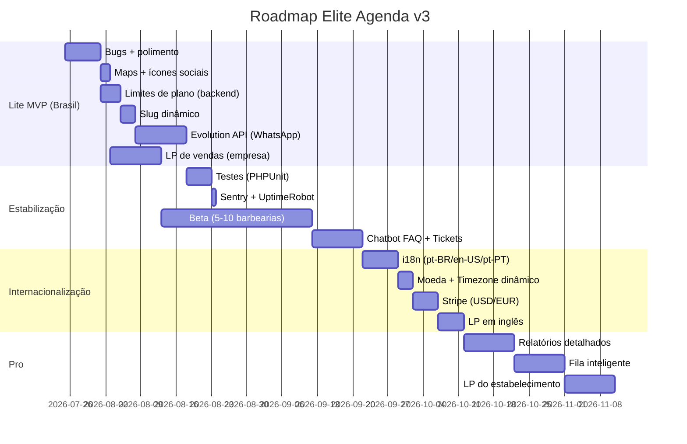

# Redução de Custos + Internacionalização

---

## O Problema: WhatsApp API Oficial é Cara

| Item | Meta Business API (Oficial) | Evolution API (Self-hosted) |
|---|---|---|
| Custo por mensagem | R$ 0,25-0,50 | **R$ 0 (grátis)** |
| 40 msg/mês por cliente | R$ 10-20/mês | R$ 0/mês |
| Requer aprovação da Meta | Sim | Não |
| Requer Facebook Business | Sim | Não |
| Precisa de servidor | Não (cloud deles) | Sim (seu VPS) |
| Estabilidade | Alta | Média-Alta (precisa monitorar) |

### O que é a Evolution API?

É um projeto open-source brasileiro ([github.com/EvolutionAPI](https://github.com/EvolutionAPI/evolution-api)) que se conecta ao WhatsApp via protocolo web (como o WhatsApp Web). Roda no seu próprio servidor.

- **Custo:** Zero por mensagem. Apenas o servidor (~R$30-50/mês numa VPS)
- **Funciona:** Envio de mensagens, templates, webhooks
- **Risco:** A Meta pode eventualmente bloquear o número se detectar automação excessiva. Mitigação: manter volume razoável, não spammar, usar delays humanos entre mensagens
- **Alternativa ao Evolution:** Baileys (lib Node.js) ou WPPConnect — mesma ideia, grátis

> [!TIP]
> **A Evolution API é amplamente usada no Brasil** por milhares de empresas de pequeno porte. É a solução padrão para quem não pode bancar a API oficial da Meta.

---

## Nova Estrutura de Custos (com Evolution API)

### Infraestrutura mínima: 1 VPS

Uma única VPS com Docker rodando tudo:

```
VPS (4GB RAM, 2 vCPU) ~ R$ 40-60/mês
├── Docker: Evolution API (WhatsApp)
├── Docker: Laravel API (Backend)
├── Docker: Nginx + Vue (Frontend)
├── Docker: PostgreSQL
└── Docker: Redis (filas/cache)
```

| Provedor | Plano | Preço |
|---|---|---|
| **Hetzner** (EU) | CX22 (4GB/2vCPU) | ~R$ 30/mês |
| **Contabo** (EU) | VPS S (8GB/4vCPU) | ~R$ 35/mês |
| **DigitalOcean** (US) | Droplet 4GB | ~R$ 50/mês |

### Custo por cliente (com Evolution API)

| Item | Custo |
|---|---|
| VPS (rateado por 100 clientes) | ~R$ 0,50 |
| WhatsApp (Evolution — self-hosted) | **R$ 0** |
| Domínio (.com.br) anual rateado | ~R$ 0,10 |
| Sentry (free tier) | R$ 0 |
| UptimeRobot (free) | R$ 0 |
| **Total por cliente/mês** | **~R$ 0,60** |

> [!NOTE]
> Com 200-500 clientes, precisará escalar para um VPS maior (~R$ 80-120/mês) ou adicionar um segundo servidor. Mesmo assim, o custo por cliente fica abaixo de R$ 1.

### Nova Margem por Plano

| Plano | Preço | Custo/cliente | **Margem** | **% Margem** |
|---|---|---|---|---|
| **Lite R$ 19,90** | R$ 19,90 | ~R$ 1 | **R$ 18,90** ✅ | 95% |
| **Lite R$ 29,90** | R$ 29,90 | ~R$ 1 | **R$ 28,90** ✅ | 97% |
| **Pro R$ 49,90** | R$ 49,90 | ~R$ 2 | **R$ 47,90** ✅ | 96% |

> [!IMPORTANT]
> **Com a Evolution API, R$ 19,90 é totalmente viável.** A margem vai de R$ 4,90 (com API oficial) para **R$ 18,90** (self-hosted). Isso muda tudo.

---

## Internacionalização: EUA e Portugal

### Por que faz sentido?

| Mercado | WhatsApp usage | Público barbershop | Moeda | Conversão |
|---|---|---|---|---|
| **Brasil** | 99% da população | Milhões de barbearias | BRL | 1x |
| **Portugal** | 85%+ | Alto (cultura similar) | EUR | ~6x |
| **EUA** | ~30% (crescendo) | Enorme, mas SMS-centric | USD | ~5.5x |

> [!NOTE]
> **Nos EUA, o WhatsApp é menos dominante** — mas no público de barbershops (muitos imigrantes latinos, brasileiros, africanos), o WhatsApp é altamente usado. Esse é seu nicho lá.

### Pricing Internacional

| Plano | Brasil (BRL) | Portugal (EUR) | EUA (USD) |
|---|---|---|---|
| **Lite** | R$ 19,90 | € 4,99 | $ 4,99 |
| **Pro** | R$ 49,90 | € 14,99 | $ 14,99 |

**Receita real convertida para BRL:**

| 1 cliente | BRL | EUR (x6) | USD (x5.5) |
|---|---|---|---|
| Lite | R$ 19,90 | **R$ 29,94** | **R$ 27,45** |
| Pro | R$ 49,90 | **R$ 89,94** | **R$ 82,45** |

> [!TIP]
> **1 cliente Lite nos EUA ($4.99) vale mais que 1 cliente Lite no Brasil (R$19.90).**
> Com o mesmo preço psicológico ("menos de 5 dólares"), você ganha 38% a mais.

### Projeção de Receita (12 meses pós-lançamento internacional)

| Mercado | Lite | Pro | Receita mensal (BRL) |
|---|---|---|---|
| Brasil (100 clientes) | 80 × R$19,90 | 20 × R$49,90 | R$ 2.590 |
| EUA (50 clientes) | 40 × $4,99 | 10 × $14,99 | R$ 1.922 |
| Portugal (30 clientes) | 25 × €4,99 | 5 × €14,99 | R$ 1.198 |
| **Total** | | | **R$ 5.710/mês** |
| Custo infra (2 VPS) | | | -R$ 120 |
| **Lucro líquido** | | | **~R$ 5.590/mês** |

> Com 300+ clientes no total, quase R$ 6k/mês com manutenção mínima.

---

## Requisitos Técnicos para Internacionalização

### O que precisa mudar no código

| Item | Esforço | Descrição |
|---|---|---|
| **i18n (idiomas)** | 🟡 Médio | Vue-i18n para pt-BR, en-US, pt-PT. Todas as strings em arquivos de tradução |
| **Moeda dinâmica** | 🟢 Baixo | Campo `currency` na tabela `shops` (BRL, USD, EUR). Formatação com `Intl.NumberFormat` |
| **Timezone** | 🟢 Baixo | Campo `timezone` na tabela `shops`. Já usar UTC no banco + conversão no front |
| **Formato de telefone** | 🟢 Baixo | Máscara dinâmica por país (libphonenumber) |
| **WhatsApp por região** | 🟢 Baixo | Evolution API funciona com números de qualquer país |
| **Slug único global** | 🟢 Baixo | `/nome-barber` ao invés de hardcoded `/elite-agenda` |
| **Stripe (pagamentos)** | 🟡 Médio | Para cobrar em USD/EUR. No Brasil: Stripe ou Asaas |

### Estrutura de i18n

```
src/
  locales/
    pt-BR.json    ← Português (Brasil)
    pt-PT.json    ← Português (Portugal)
    en-US.json    ← English (US)
```

```json
// pt-BR.json
{
  "booking": {
    "title": "Agendamento",
    "select_service": "Serviços Exclusivos",
    "select_professional": "Especialista",
    "confirm": "Reservar Horário"
  }
}

// en-US.json
{
  "booking": {
    "title": "Booking",
    "select_service": "Our Services",
    "select_professional": "Your Barber",
    "confirm": "Book Now"
  }
}
```

---

## Stack Final de Baixo Custo

```
┌─────────────────────────────────────┐
│           VPS (Hetzner/Contabo)     │
│               ~R$ 40/mês           │
│                                     │
│  ┌──────────┐  ┌────────────────┐  │
│  │ Nginx    │  │ Laravel API    │  │
│  │ + Vue    │  │ (PHP-FPM)      │  │
│  │ (Front)  │  │ (Backend)      │  │
│  └──────────┘  └────────────────┘  │
│                                     │
│  ┌──────────┐  ┌────────────────┐  │
│  │PostgreSQL│  │ Evolution API  │  │
│  │ (Banco)  │  │ (WhatsApp)     │  │
│  └──────────┘  └────────────────┘  │
│                                     │
│  ┌──────────┐  ┌────────────────┐  │
│  │  Redis   │  │ Sentry (free)  │  │
│  │ (Cache)  │  │ UptimeRobot    │  │
│  └──────────┘  └────────────────┘  │
└─────────────────────────────────────┘

Ferramentas grátis:
  - Sentry: Monitoramento de erros
  - UptimeRobot: Uptime monitoring  
  - Cloudflare: CDN + SSL + DDoS (free)
  - GitHub: Repositório + CI/CD Actions
```

---

## Roadmap Atualizado


